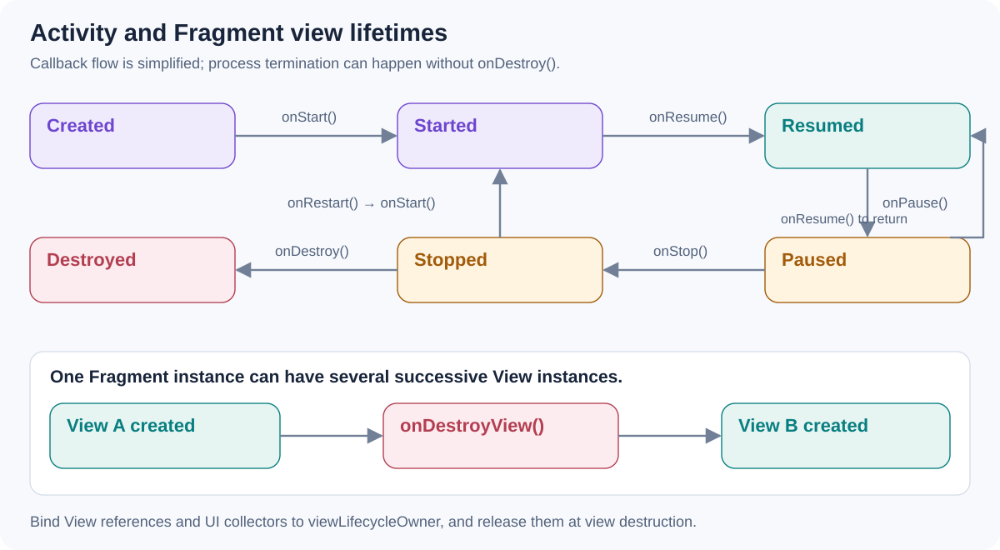

# Explain the Activity lifecycle. How does it differ from the lifecycle of a Fragment's view?

[Back to questions](../../README.md#android-core)

**Level:** Junior · **Topic:** Android Core

## Answer

An Activity usually moves through `onCreate`, `onStart`, and `onResume` as it becomes interactive, then `onPause` and `onStop` as it leaves the foreground. Destruction can mean finishing or recreation; process termination may happen without `onDestroy`.

A Fragment has both its own lifecycle and a separate lifecycle for its View. The Fragment may remain on a back stack after its View has been destroyed. UI references and observers should therefore follow `viewLifecycleOwner`. Pause does not universally mean invisible, especially in multi-window configurations; choose lifecycle thresholds based on the work's actual needs.

## References

- [Android: Activity lifecycle](https://developer.android.com/guide/components/activities/activity-lifecycle)
- [Android: Fragment lifecycle](https://developer.android.com/guide/fragments/lifecycle)
