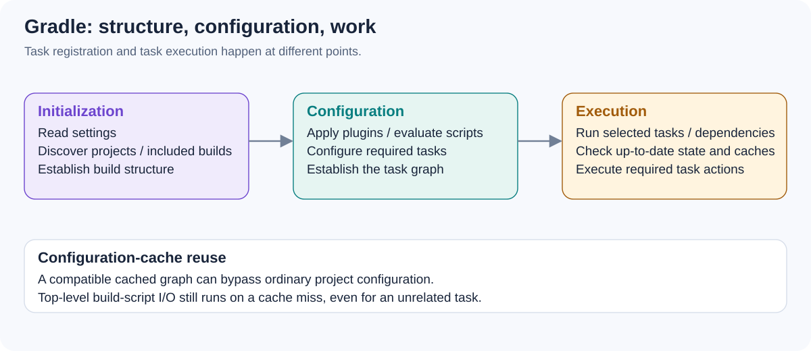

# Explain Gradle initialization, configuration, and execution. Why can configuration-time work slow down an unrelated task?

[Back to questions](../../README.md#gradle-and-gradle-dsl)

**Level:** Junior · **Topic:** Gradle and Gradle DSL · **Reviewed:** 2026-10-29

## Answer

Initialization discovers settings, included projects, and relevant builds. Configuration evaluates required build logic, applies plugins, and establishes the model and task graph. Execution runs the selected tasks and their dependencies, subject to up-to-date and caching decisions.

A network call or expensive computation in a build script runs as configuration work when that script is evaluated, even if the requested task does not need the resulting task action. Lazy task registration avoids some unnecessary task configuration; it does not make arbitrary top-level script code lazy.

A reusable configuration-cache entry can bypass ordinary configuration work for a compatible request. Keep that distinction in mind when interpreting a warm build: its speed may come from reusing configuration rather than fixing the expensive work that still occurs after invalidation.

## References

- [Gradle: build lifecycle](https://docs.gradle.org/current/userguide/build_lifecycle.html)
