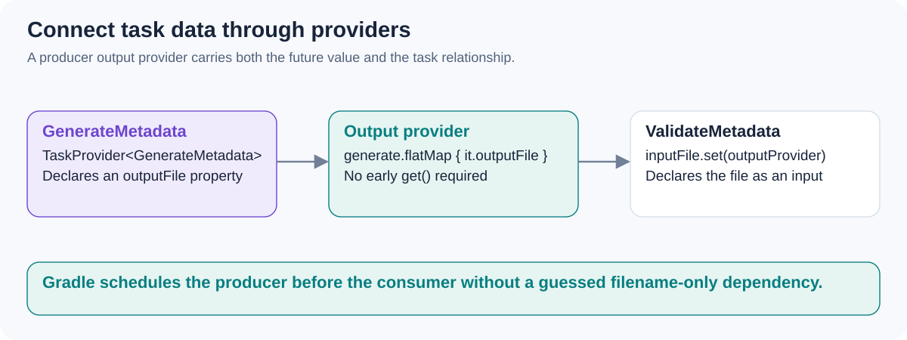

# How do producer/consumer providers, `dependsOn`, `mustRunAfter`, and `finalizedBy` differ?

[Back to questions](../../README.md#gradle-and-gradle-dsl)

**Level:** Middle · **Topic:** Gradle and Gradle DSL · **Reviewed:** 2026-10-29

## Answer



Prefer expressing a real data relationship: connect a consumer's input property to a producer's output provider. Gradle can then infer the dependency and obtain the output at the correct time.

```kotlin
// These task types expose a RegularFileProperty for input/output.
val generate = tasks.register<GenerateMetadata>("generateMetadata")
tasks.register<ValidateMetadata>("validateMetadata") {
    inputFile.set(generate.flatMap { it.outputFile })
}
```

`dependsOn` adds work that must be scheduled before the dependent task. `mustRunAfter` only imposes order when both tasks are already scheduled; it does not schedule the other task. `finalizedBy` schedules finalization associated with a task, including documented failure/up-to-date cases.

Passing only a guessed filesystem path can lose the producer relationship. Do not fix every ordering failure with a broad dependsOn or a task-name string: model the actual input/output contract. Finalizers are useful for cleanup, but cannot guarantee cleanup after a process is forcibly terminated.

## References

- [Gradle: task dependencies, ordering, and finalizers](https://docs.gradle.org/current/userguide/controlling_task_execution.html)
- [Gradle: provider-backed dependency wiring](https://docs.gradle.org/current/userguide/lazy_configuration.html)
