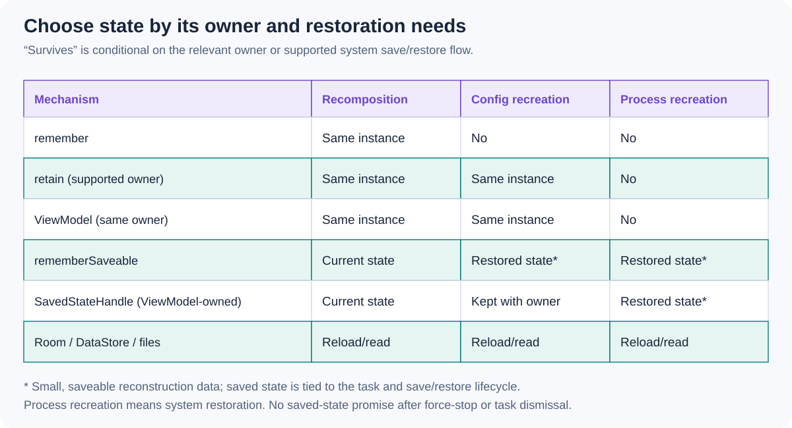

# Runtime 1.10 - compare `retain`, `remember`, `rememberSaveable`, and `ViewModel`. Which lifetimes and restoration guarantees differ?

[Back to questions](../../README.md#jetpack-compose-versions)

**Level:** Middle · **Topic:** Jetpack Compose Versions · **Reviewed:** 2026-10-29

## Answer

`remember` keeps a value while its composition identity remains. `retain` is available in `androidx.compose.runtime:runtime-retain` from 1.10; retaining across configuration changes also requires the supporting Compose UI integration from 1.10. It preserves a non-serialized instance across configuration recreation, but not process death. Unused retained values are retired when their owning content is permanently removed.

`rememberSaveable` serializes a supported representation for saved-state restoration. A ViewModel belongs to a ViewModelStore owner and provides a suitable home for screen logic, coroutine ownership, and saved-state/DI integrations.

Choose by responsibility and lifetime, not only by whether rotation works. A composable-local cache can fit retain; repository-backed screen state often fits a ViewModel. Persist durable data separately, and check the specific API's opt-in and library requirements.

## References

- [Android: Compose state lifespans](https://developer.android.com/develop/ui/compose/state-lifespans)
