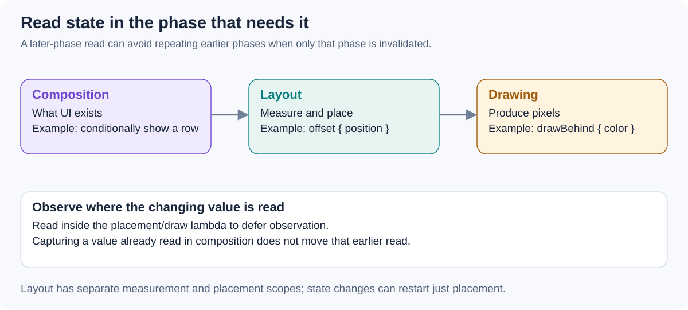

# Composition, layout, and drawing - how would you locate expensive work and defer state reads to the appropriate phase?

[Back to questions](../../README.md#jetpack-compose)

**Level:** Senior · **Topic:** Jetpack Compose

## Answer

Composition establishes what UI exists, layout measures and places it, and drawing produces pixels. State observations are associated with the phase where they occur, allowing later phases to restart without always repeating earlier ones.

Use tracing to find expensive work and its invalidation path. If a changing value only affects placement or drawing, a lambda-based layout or draw modifier can defer the state read to that phase. Moving the read matters; wrapping an already-read value in a lambda does not undo the earlier observation. Keep business computations outside frame-critical paths and verify the optimization in a representative build.

## References

- [Android: Compose phases](https://developer.android.com/develop/ui/compose/phases)
