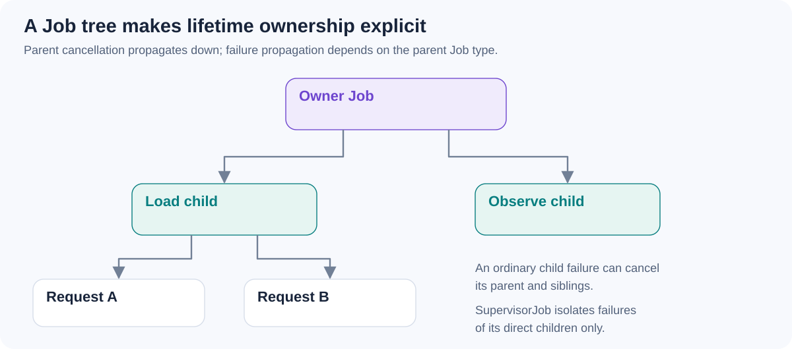

# Structured concurrency - how do a `CoroutineScope`, its `Job`, and child coroutines relate?

[Back to questions](../../README.md#kotlin-coroutines)

**Level:** Middle · **Topic:** Kotlin Coroutines

## Answer

A CoroutineScope supplies a context, typically including a Job and dispatcher. Builders create child coroutines in that ownership structure. Parents wait for children to complete, and cancellation propagates downward; ordinary child failures can also fail their parent.

This structure lets a caller reason about when related work ends. Replacing the parent Job or launching in an unrelated scope can detach work and defeat those guarantees.

Structured concurrency is about lifetime and propagation, not a guarantee that all children execute in parallel or that their shared state is safe. An explicitly long-lived scope needs an owner that knows when to cancel it.

## References

- [kotlinx.coroutines: CoroutineScope and structured concurrency](https://kotlinlang.org/api/kotlinx.coroutines/kotlinx-coroutines-core/kotlinx.coroutines/-coroutine-scope/)
