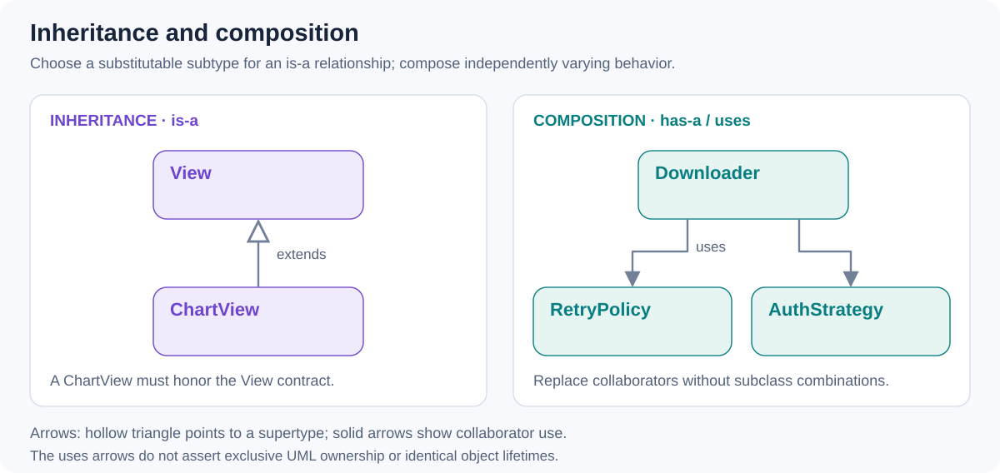

# Composition vs. inheritance - when would you choose each?

[Back to questions](../../README.md#oop)

**Level:** Middle · **Topic:** OOP

## Answer



Composition gives an object collaborators; inheritance gives a subtype the behavior and contract of a parent. Prefer composition when behavior varies independently or must be replaced in tests. For example, inject a retry policy into a downloader instead of creating subclasses for every retry and authentication combination.

Inheritance fits a genuine substitutable relationship or a framework extension point such as `View`. The subtype must honor the parent's contract; merely wanting to reuse a few methods is insufficient.

```kotlin
class Downloader(private val retry: RetryPolicy)
```

Kotlin delegation with `by` can forward an interface to a collaborator. Composition adds explicit wiring, while inheritance adds coupling to parent behavior and protected implementation details.

## References

- [Kotlin: inheritance](https://kotlinlang.org/docs/inheritance.html)
- [Kotlin: delegation](https://kotlinlang.org/docs/delegation.html)
