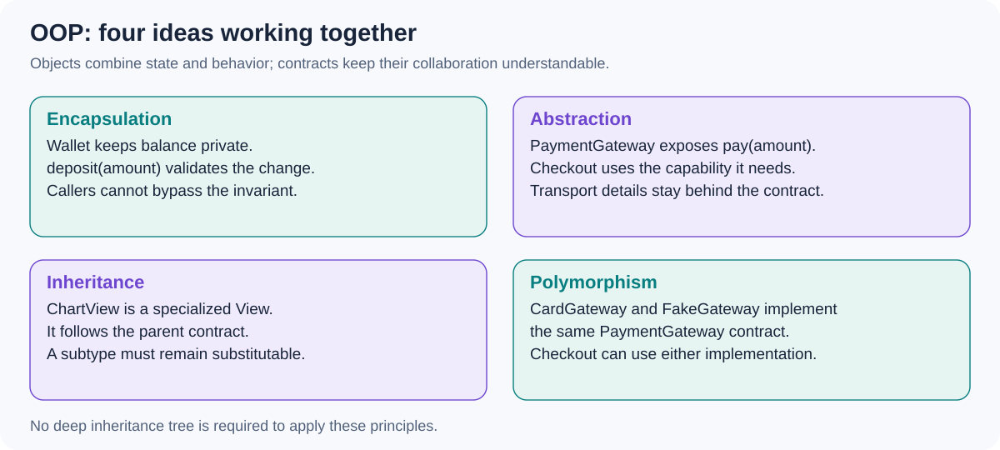

# What is OOP? (in English, since our native language is Russian)

[Back to questions](../../README.md#oop)

**Level:** Junior · **Topic:** OOP

## Answer



Object-oriented programming models a system as cooperating objects that combine state and behavior. A class defines a type; an object is an instance of it.

Encapsulation protects an object's invariants, abstraction exposes the operations callers need, inheritance expresses a subtype relationship, and polymorphism lets callers use different implementations through the same contract. These ideas do not require deep inheritance trees.

```kotlin
interface PaymentGateway { suspend fun pay(amount: Long) }
class Checkout(private val gateway: PaymentGateway) {
    suspend fun submit(amount: Long) {
        require(amount > 0)
        gateway.pay(amount)
    }
}
```

`Checkout` depends on an abstraction and preserves a simple invariant. A useful interview explanation connects the principles to maintainability and testability, rather than only listing their names.

## References

- [Oracle: object-oriented concepts](https://docs.oracle.com/javase/tutorial/java/concepts/)
