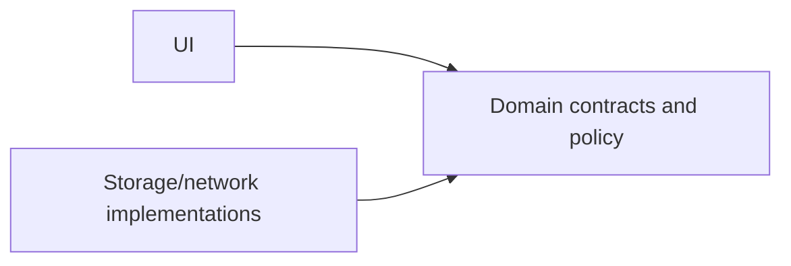

# Clean Architecture and the dependency rule - where would you draw module boundaries, and what complexity would you avoid in a small app?

[Back to questions](../../README.md#patterns-and-architecture)

**Level:** Senior · **Topic:** Patterns and Architecture

## Answer

The dependency rule directs source-code dependencies toward more stable policy. Domain behavior should not need an Activity, Retrofit response, or SQLite cursor merely to express a business rule. Interfaces allow data/framework implementations to satisfy inward-facing contracts.

Draw module boundaries around ownership, independent change, reuse, and build constraints. Map transport and persistence models where that protects useful contracts; do not create identical models and forwarding layers automatically.

For a small app, packages and constructor injection may provide enough separation. More modules add configuration and navigation/DI wiring. Judge the design by whether behavior can be tested and changed independently, not by the number of concentric layers.

## References

- [Robert C. Martin: Clean Architecture](https://blog.cleancoder.com/uncle-bob/2012/08/13/the-clean-architecture.html)
- [Android: modularization](https://developer.android.com/topic/modularization)
