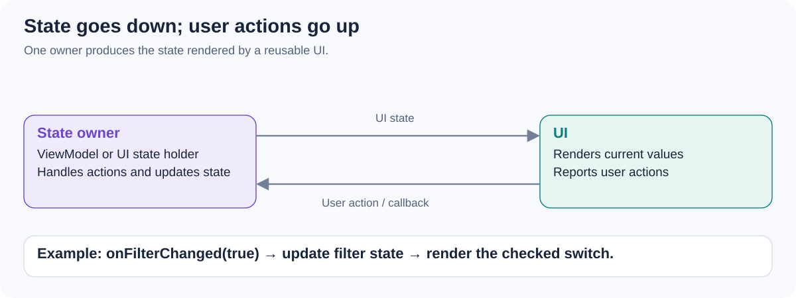

# Explain Unidirectional Data Flow (UDF). How do UI state and user actions move through the app?

[Back to questions](../../README.md#patterns-and-architecture)

**Level:** Middle · **Topic:** Patterns and Architecture

## Answer

In UDF, an owner exposes state to the UI, the UI renders it, and user actions return to the owner. Updates produce the next state instead of letting several widgets mutate competing copies of application data.

For example, a filter switch sends an action; the owner updates the filter and resulting data, and the next state renders the screen. This makes transitions easier to test and reason about.

UDF does not require routing every small local animation through a global reducer. Choose the appropriate state owner and keep side-effect ownership explicit. Thread safety and persistence remain separate concerns.

## References

- [Android: UI state and UDF](https://developer.android.com/topic/architecture/ui-layer/stateholders)
