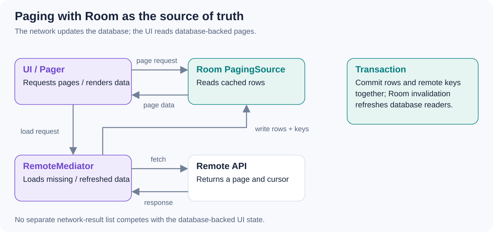

# How would you combine Room, Paging 3, and `RemoteMediator` for a list backed by a local database and a remote API?

[Back to questions](../../README.md#room-and-datastore)

**Level:** Senior · **Topic:** Room and DataStore

## Answer

Use Room as the UI's source of truth. A DAO provides a `PagingSource`, while `RemoteMediator` fetches missing or refreshed pages and writes them into the database. Database invalidation then updates the paged UI.

Store page keys or cursors with the records in one transaction so an interrupted update cannot leave inconsistent pagination metadata. Define refresh policy, end-of-pagination behavior, and cache lifetime. Surface refresh and append errors separately, preserving cached content when possible. Do not independently merge network results into the UI list while also treating Room as authoritative.

## References

- [Android: Paging with network and database](https://developer.android.com/topic/libraries/architecture/paging/v3-network-db)
